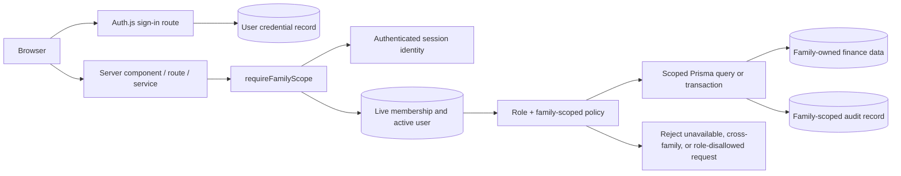

# Phase 1: Protected Family Access - Research

**Researched:** 2026-10-23  
**Domain:** Server-side authentication, role authorization, and PostgreSQL family isolation  
**Confidence:** MEDIUM

<user_constraints>
## User Constraints (from CONTEXT.md)

### Locked Decisions

### 1. Authentication

Preserve the existing login, credential and session mechanisms.

Do not introduce public registration.

Do not recreate the authentication subsystem.

### 2. Authorization

ADMIN can configure financial accounts and categories, manage permitted transactions and inspect audit history.

FAMILY can access authorized family financial information and perform permitted financial operations.

Authorization must be enforced server-side.

Client-side role checks are not security boundaries.

### 3. Family Isolation

The first operational release serves one family.

The data model must establish explicit family ownership or membership so future multi-family expansion is possible.

The authorized family scope must be derived from the authenticated server-side identity.

Never accept a client-provided family identifier as authorization.

Every relevant financial read and write must enforce that scope.

### 4. Database Compatibility

Preserve existing users, financial tables and audit history.

Prefer additive, incremental Prisma migrations.

Plan existing-record backfills before introducing required family relationships.

Avoid destructive schema changes.

No production migration without an approved backup and deployment procedure.

### 5. Financial Integrity

Preserve Decimal(14,2) financial precision.

Preserve atomic transfers and audit records.

Do not alter opening balances or existing financial events merely to establish family membership.

### the agent's Discretion

None stated.

### Deferred Ideas (OUT OF SCOPE)

- Rebuilding the dashboard.
- Implementing financial entry forms.
- Importing WhatsApp records.
- Debt management.
- Multi-family onboarding.
- Production data migration during this planning task.
</user_constraints>

<phase_requirements>
## Phase Requirements

| ID | Description | Research Support |
|----|-------------|------------------|
| AUTH-01 | Administrators and family members can authenticate through the existing sign-in flow. | Preserve the Credentials provider, password verification, session callbacks, and server-side `requireUser` path. |
| AUTH-02 | The application enforces distinct permissions for family members who record movements and administrators who configure accounts and categories and review discrepancies. | Retain current role policy and apply it after resolving a live server-side family scope. |
| AUTH-03 | Every financial read and write is scoped to the family authorized by the authenticated server-side session. | Add explicit family membership/ownership, centralized scope resolution, relational filters, in-transaction reference validation, and two-family isolation tests. |
</phase_requirements>

## Summary

Phase 1 should extend the existing server-only protection path instead of introducing another authentication layer. The application already authenticates through an Auth.js Credentials provider, copies the signed-in user's role to a JWT/session, and re-reads the active user from PostgreSQL in `requireUser`. The existing roles are exactly `ADMIN` and `FAMILY`: `enum UserRole { ADMIN FAMILY }`. [VERIFIED: prisma/schema.prisma:10-13] The database lookup in `requireUser` is the appropriate boundary to resolve a current family membership before returning an actor to finance services. [VERIFIED: src/lib/auth/guards.ts:7-24]

The critical gap is tenant isolation: the current schema has no family relationship, and services select accounts, categories, transactions, transfers, and summaries by global identifiers or global lists. For example, `getAccountBalance` obtains an account with `findUnique({ where: { id: accountId } })`; transaction and transfer reference validators use the same global-ID pattern. [VERIFIED: src/lib/finance/services/queries.ts:35-73; src/lib/finance/services/references.ts:15-82] Role checks alone therefore cannot meet AUTH-03. The plan must impose server-derived family scope on every read, object lookup, reference check, and mutation inside its Prisma transaction.

**Primary recommendation:** Create an additive `Family` plus membership/ownership boundary, backfill the existing single family before constraints become required, and route every finance service through one fresh server-side family-scope resolver. [CITED: https://www.prisma.io/docs/guides/database/data-migration]

## Architectural Responsibility Map

| Capability | Primary Tier | Secondary Tier | Rationale |
|------------|-------------|----------------|-----------|
| Credentials sign-in and session issuance | Frontend Server (SSR) | Database / Storage | Auth.js handles the request/session flow; PostgreSQL supplies the active user and credential record. [VERIFIED: src/auth.ts:7-98] |
| Current actor and family-scope resolution | API / Backend | Database / Storage | The server must derive authorization data from the authenticated identity and live membership. [VERIFIED: src/lib/auth/guards.ts:7-34] |
| Role authorization | API / Backend | — | The existing role policy is an explicit finance-domain guard, not a client concern. [VERIFIED: src/lib/finance/authorization.ts:12-48] |
| Family-scoped finance reads | API / Backend | Database / Storage | Queries must add scope predicates at the persistence boundary for each requested object and list. [VERIFIED: src/lib/finance/services/queries.ts:35-170] |
| Family-scoped finance writes and reference checks | API / Backend | Database / Storage | A transaction must verify every referenced account/category/transfer endpoint belongs to the resolved family before mutation and audit append. [VERIFIED: src/lib/finance/services/transactions.ts:53-197; src/lib/finance/services/transfers.ts:49-190] |
| Family ownership and legacy backfill | Database / Storage | API / Backend | Prisma migration data and relations establish the durable ownership boundary before application code relies on it. [CITED: https://www.prisma.io/docs/guides/database/data-migration] |

## Standard Stack

### Core

| Library | Version | Purpose | Why Standard |
|---------|---------|---------|--------------|
| `next-auth` | `5.0.0-beta.32` | Existing Credentials/JWT/session flow | Reuse the locked authentication mechanism. The manifest declares this exact version. [VERIFIED: package.json:24-38] |
| Prisma + PostgreSQL | `7.10.1` + existing PostgreSQL datastore | Additive schema migration and scoped persistence | The schema and generated Prisma client already own persistence; no second data-access layer is needed. [VERIFIED: package.json:24-38; prisma/schema.prisma:1-8] |
| Zod | `^4.6.7` | Existing service-boundary input parsing | Retain parsing for client input, while deriving authorization scope on the server. [VERIFIED: package.json:24-38; src/lib/finance/services/transactions.ts:53-60] |
| Node test runner + `tsx` | `node --import tsx --test` | Existing automated test command | Use the present test runner for role and isolation coverage. [VERIFIED: package.json:7-17] |

### Supporting

| Library | Version | Purpose | When to Use |
|---------|---------|---------|-------------|
| `bcryptjs` | `^3.0.3` | Existing password comparison | Preserve sign-in verification; do not reimplement password hashing. [VERIFIED: package.json:24-38; src/auth.ts:42-45] |
| `@prisma/adapter-pg` / `pg` | `7.10.1` / `^8.23.1` | Existing PostgreSQL Prisma adapter | Keep the existing client path for service and integration tests. [VERIFIED: package.json:24-38; src/lib/prisma.ts:1-24] |

### Alternatives Considered

No replacement authentication, ORM, or authorization package is in scope. The locked decision is to reuse the existing Auth.js, Prisma, and finance-service architecture. [VERIFIED: 01-CONTEXT.md:25-31]

**Installation:** No new external package is required for this phase. [VERIFIED: 01-CONTEXT.md:27-31]

## Package Legitimacy Audit

No package installation is recommended. The existing package manifest is the stack inventory, so the package-legitimacy gate does not create an installation task. [VERIFIED: package.json:24-50]

## Architecture Patterns

### System Architecture Diagram



The diagram's `requireFamilyScope` name and `Family` fields are a proposed internal design, not existing code. [ASSUMED]

### Recommended Project Structure

```text
src/lib/auth/
  guards.ts                 # extend live server-side actor/family resolution
src/lib/finance/
  authorization.ts          # retain role policy; add scope-aware policy helpers
  services/                 # every exported read/write obtains scope here
  services/references.ts    # verifies all supplied IDs belong to resolved scope
prisma/
  schema.prisma             # additive family, membership, and ownership relations
  migrations/               # reviewed expand/backfill migration
tests/
  finance-authorization.test.ts
  family-isolation.test.ts  # proposed focused scope test seam
```

The final family model and test filename require a plan decision; this is a planning map, not a present file layout. [ASSUMED]

### Pattern 1: Resolve an authoritative server-side scope once

**What:** Add a server-only helper that starts from `auth()`, then reads the active `User` and its family membership from Prisma. It returns a trusted actor/scope object for internal service use only. [VERIFIED: src/lib/auth/guards.ts:7-24]

**When to use:** At the beginning of every finance service operation and before a transaction begins. Never accept a family identifier from a form, action payload, query parameter, or client session update as authority. [VERIFIED: 01-CONTEXT.md:49-53]

**Example (proposed skeleton; names are not yet schema values):**

```ts
// [ASSUMED] The helper obtains familyId from live server data; input has no familyId.
const scope = await requireFamilyScope();
return prisma.financialAccount.findMany({
  where: { familyId: scope.familyId },
});
```

Auth.js documents that values added to a JWT must be deliberately exposed by the session callback; this supports keeping family authority in a live server lookup instead of treating browser-visible session content as the source of truth. [CITED: https://authjs.dev/reference/core]

### Pattern 2: Scope every object reference inside the mutation transaction

**What:** Pass the resolved family scope to reference validation. Account/category references for a transaction, and both origin/destination accounts for a transfer, must be looked up with the family predicate using the transaction client. [VERIFIED: src/lib/finance/services/references.ts:15-82]

**When to use:** Create, update, and cancel transactions/transfers; account/category updates; any future service with an ID parameter. Returning the same not-found-style domain error for foreign and missing IDs avoids an object-existence oracle. The error-shape choice is a recommended implementation detail. [ASSUMED]

### Pattern 3: Expand, backfill, validate, then require

**What:** First add family/membership structures and nullable ownership relations; create one initial family and attach all existing users and records; verify counts and referential consistency; only then introduce non-null and uniqueness constraints in a reviewed follow-up migration. [CITED: https://www.prisma.io/docs/guides/database/data-migration]

**When to use:** This phase has existing `User`, financial, and `AuditLog` records that must be retained. [VERIFIED: prisma/schema.prisma:44-155]

### Anti-Patterns to Avoid

- **Client-selected family scope:** A payload or URL parameter can filter presentation but must never determine authorization. [VERIFIED: 01-CONTEXT.md:49-53]
- **Role-only guards:** Current role checks allow an authenticated `FAMILY` actor to pass read/create authorization; they carry no family data. [VERIFIED: src/lib/finance/authorization.ts:12-26; src/lib/finance/types.ts:1-6]
- **Parent-list-only filtering:** Filtering list results is insufficient when a direct `id` read/update/reference lookup remains global. [VERIFIED: src/lib/finance/services/queries.ts:35-73; src/lib/finance/services/transactions.ts:116-197]
- **A non-transactional ownership check:** Reference validation, mutation, and audit append must remain inside the existing Prisma transaction. [VERIFIED: src/lib/finance/services/transactions.ts:59-75; src/lib/finance/services/transfers.ts:55-71]
- **Replacing or editing historical money to backfill ownership:** Ownership data must be added without altering opening balances, amounts, or financial events. [VERIFIED: 01-CONTEXT.md:67-73]

## Don't Hand-Roll

| Problem | Don't Build | Use Instead | Why |
|---------|-------------|-------------|-----|
| Login/session issuance | A new custom cookie/token system | Existing Auth.js Credentials, JWT, and callbacks | The existing provider already controls credential authorization and session lifecycle. [VERIFIED: src/auth.ts:7-98] |
| Password verification | String comparisons or custom hashes | Existing `bcrypt.compare` flow | Password verification is already implemented with bcrypt. [VERIFIED: src/auth.ts:42-45] |
| Schema/data deployment | Manual production SQL or a destructive reset | Reviewed additive Prisma migrations and an approved backup/deployment procedure | The context explicitly forbids production changes during planning and requires additive migrations. [VERIFIED: 01-CONTEXT.md:55-65] |
| Multi-step financial mutation | Separate independent database writes | Existing `prisma.$transaction` plus `recordAudit` | The current services preserve mutation/audit atomicity. [VERIFIED: src/lib/finance/services/transactions.ts:59-75; src/lib/finance/audit.ts:3-22] |

**Key insight:** A compact, centralized scope helper plus relational predicates is safer than scattered client role checks because a single missed global-ID query would disclose or mutate another family's data. [CITED: https://cheatsheetseries.owasp.org/cheatsheets/Authorization_Cheat_Sheet.html]

## Common Pitfalls

### Pitfall 1: Treating the JWT/session as the current authorization record

**What goes wrong:** A deactivated user or removed membership can retain access until token expiry if services authorize only from client-visible claims. [ASSUMED]

**How to avoid:** Continue the existing pattern of resolving the session identity to a fresh `User` query, and extend that query to live membership/family data. [VERIFIED: src/lib/auth/guards.ts:7-24]

### Pitfall 2: Global `findUnique` during writes

**What goes wrong:** The current update/cancel paths load a transaction or transfer only by `id`, then apply role/author policy. A valid family user could target an ID belonging to a different family once multiple families exist. [VERIFIED: src/lib/finance/services/transactions.ts:116-197; src/lib/finance/services/transfers.ts:111-190]

**How to avoid:** Use a family-scoped lookup before applying modification policy and before any update; foreign IDs must fail before audit creation. [ASSUMED]

### Pitfall 3: Cross-family transfer endpoints

**What goes wrong:** Validating only the origin account permits a transfer that points to another family's account. [ASSUMED]

**How to avoid:** Validate both endpoints against the same resolved family within the transaction. The existing validator already obtains both endpoints together, making it the natural enforcement point. [VERIFIED: src/lib/finance/services/references.ts:54-82]

### Pitfall 4: Making a required relation before backfill

**What goes wrong:** Existing users/history prevent migration completion or receive an invented default ownership assignment without a reviewed record count. [CITED: https://www.prisma.io/docs/guides/database/data-migration]

**How to avoid:** Plan explicit initial-family creation, deterministic legacy attachment, validation queries/counts, and only then a required relation. Preserve `Decimal(14,2)` fields: `initialBalance Decimal @db.Decimal(14, 2)` and `amount Decimal @db.Decimal(14, 2)`. [VERIFIED: prisma/schema.prisma:78-92; prisma/schema.prisma:107-155]

### Pitfall 5: Forgetting audit-log tenancy

**What goes wrong:** An audit-history route can disclose another family's actions even when financial records are filtered. The present audit model only records actor/action/entity/metadata and has no family relation. [VERIFIED: prisma/schema.prisma:64-76]

**How to avoid:** Select a durable audit-family ownership strategy in the migration and append it from the same transaction as each finance mutation. [ASSUMED]

## Code Examples

### Scope-aware reference validation

```ts
// [ASSUMED] Final Prisma model/field names must be selected in the plan.
async function loadAccountInScope(db: Prisma.TransactionClient, scope: FamilyScope, id: string) {
  return db.financialAccount.findFirst({
    where: { id, familyId: scope.familyId },
  });
}
```

Use the same scope object for the account/category lookup, both transfer endpoints, target transaction/transfer lookups, and all list/summary filters. This follows the existing service layout where reference validation runs inside `prisma.$transaction`. [VERIFIED: src/lib/finance/services/references.ts:15-82; src/lib/finance/services/transactions.ts:59-75]

## State of the Art

| Old Approach | Current Approach | Impact |
|--------------|------------------|--------|
| Client-side role display or global-ID lookup | Server-side, object-specific authorization for every request | Prevents IDOR and privilege escalation paths. [CITED: https://cheatsheetseries.owasp.org/cheatsheets/Authorization_Cheat_Sheet.html] |
| Direct required schema change | Expand, backfill, switch, then contract | Preserves compatibility during data-model evolution. [CITED: https://www.prisma.io/docs/guides/database/data-migration] |

## Assumptions Log

| # | Claim | Section | Risk if Wrong |
|---|-------|---------|---------------|
| A1 | A `Family` plus membership relationship is the preferred representation; final model/field names and cardinality remain undecided. | Architecture Patterns | A schema that limits future membership or complicates safe scoping. |
| A2 | Family ownership can be held on financial roots and enforced through relational queries, with an explicit durable strategy for audit history. | Architecture Patterns | An omitted entity or weak predicate could leave a cross-family path. |
| A3 | A focused test seam can exercise every service's scope predicate without accepting a caller-provided family identifier in production. | Validation Architecture | Tests could validate helpers while missing the actual service boundary. |
| A4 | Foreign and nonexistent IDs should share a safe rejection shape. | Common Pitfalls | Object-existence disclosure or inconsistent API behavior. |

## Open Questions

1. **What is the approved schema cardinality for membership?**
   - What we know: the initial release serves one family but the model must support future expansion. [VERIFIED: 01-CONTEXT.md:43-53]
   - What's unclear: whether a `User` owns one family directly or joins through a membership table, and whether roles remain global or become family-specific later.
   - Recommendation: use a `Family` plus membership relation unless the technical reviewer selects a narrower documented model; retain current `User.role` behavior for this phase.

2. **Which records receive direct ownership columns?**
   - What we know: present financial roots, events, and audit records have no family relation. [VERIFIED: prisma/schema.prisma:64-155]
   - What's unclear: direct `familyId` on each record versus relational derivation for transactions/transfers, and the audit record linkage contract.
   - Recommendation: decide this before writing the migration; list each model and its family predicate in the plan's acceptance checks.

3. **How will the one legacy family be identified and backfilled?**
   - What we know: initial users are created by role and current seed exits when one user for a role exists. [VERIFIED: prisma/seed.ts:5-46]
   - What's unclear: the approved display/name identifier for the created family and a count-based proof of attaching all existing rows.
   - Recommendation: make the initial-family identity and backfill verification explicit review checkpoints; do not alter money/event values.

4. **What becomes the per-family uniqueness contract?**
   - What we know: account names are globally unique and categories are globally unique by `name,type`. [VERIFIED: prisma/schema.prisma:78-105]
   - What's unclear: whether future expansion requires compound family-scoped uniqueness now.
   - Recommendation: have the planner flag this migration design choice for technical review rather than silently retaining a global business constraint.

## Environment Availability

| Dependency | Required By | Available | Version | Fallback |
|------------|-------------|-----------|---------|----------|
| Node.js | Typecheck and test runner | ✓ | `v24.15.0` | — |
| npm | Existing scripts | ✓ | `11.12.1` | — |
| Docker Compose | Local PostgreSQL workflow documented by project | ✗ | — | Provide a configured PostgreSQL test database. |
| `TEST_DATABASE_URL` | PostgreSQL integration/isolation validation | ✗ in this session | — | Configure an isolated PostgreSQL test database. |

**Missing dependencies with no fallback:** Docker Compose or a provisioned isolated PostgreSQL test database is required before executing database-backed isolation validation. [VERIFIED: README.md; package.json:13-17]

**Missing dependencies with fallback:** Docker is absent, but a separately provisioned `TEST_DATABASE_URL` can support the existing PostgreSQL integration-test pattern. [VERIFIED: tests/finance-postgres.test.ts:7-13]

## Validation Architecture

### Test Framework

| Property | Value |
|----------|-------|
| Framework | Node test runner via `tsx` [VERIFIED: package.json:7-17] |
| Config file | none; test discovery is the package script glob [VERIFIED: package.json:7-17] |
| Quick run command | `npm test` [VERIFIED: package.json:7-17] |
| Full suite command | `npm run lint && npm run typecheck && npm test` [VERIFIED: package.json:7-17] |

### Phase Requirements → Test Map

| Req ID | Behavior | Test Type | Automated Command | File Exists? |
|--------|----------|-----------|-------------------|-------------|
| AUTH-01 | Existing active ADMIN/FAMILY credentials still produce a server-recognized session and inactive users are rejected. | route/service integration | `npm test` | ❌ Wave 0 |
| AUTH-02 | FAMILY cannot manage catalog; permitted role operations retain access. | unit | `npm test` | ✅ partial: `tests/finance-authorization.test.ts` |
| AUTH-03 | Two families cannot read, update, cancel, reference, or transfer through each other's records; summaries/list queries are filtered. | unit plus PostgreSQL integration | `npm test` with configured `TEST_DATABASE_URL` | ❌ Wave 0 |

### Sampling Rate

- **Per task commit:** `npm test`
- **Per wave merge:** `npm run lint && npm run typecheck && npm test`
- **Phase gate:** Full suite green with an isolated PostgreSQL database before `$gsd-verify-work`.

### Wave 0 Gaps

- [ ] A narrow server-only test seam for a resolved family scope, used by production service entry points and test fixtures. [ASSUMED]
- [ ] Two-family fixtures covering accounts, categories, transactions, transfers, memberships, and audit history. [ASSUMED]
- [ ] Tests for every current exported finance service: `listFinancialAccounts`, `createFinancialAccount`, `updateFinancialAccount`, `listCategories`, `createCategory`, `updateCategory`, `getAccountBalance`, `getConsolidatedSummary`, transaction create/list/update/cancel, and transfer create/list/update/cancel. [VERIFIED: src/lib/finance/services/index.ts:1-5; src/lib/finance/services/accounts.ts:20-130; src/lib/finance/services/categories.ts:23-129; src/lib/finance/services/queries.ts:35-170; src/lib/finance/services/transactions.ts:53-197; src/lib/finance/services/transfers.ts:49-190]
- [ ] A configured isolated `TEST_DATABASE_URL` or Docker Compose before PostgreSQL integration tests can execute. [VERIFIED: tests/finance-postgres.test.ts:7-13]

## Security Domain

### Applicable ASVS Categories

| ASVS Category | Applies | Standard Control |
|---------------|---------|-----------------|
| V2 Authentication | yes | Preserve Credentials input validation, bcrypt verification, active/locked-user checks, and no public registration. [VERIFIED: src/auth.ts:17-75; 01-CONTEXT.md:25-31] |
| V3 Session Management | yes | Preserve JWT strategy; authenticate on the server and resolve live authorization data before finance operations. [VERIFIED: src/auth.ts:12-15; src/lib/auth/guards.ts:7-24] |
| V4 Access Control | yes | Role policy plus server-derived family predicates on every object read/write. [CITED: https://github.com/OWASP/ASVS/blob/master/4.0/en/0x12-V4-Access-Control.md] |
| V5 Input Validation | yes | Continue Zod parsing for input; never parse a client family ID as authorization. [VERIFIED: src/lib/finance/services/transactions.ts:53-60; 01-CONTEXT.md:49-53] |
| V6 Cryptography | yes | Reuse bcrypt password verification and Auth.js secret-managed JWT/session mechanism; no custom cryptography. [VERIFIED: src/auth.ts:42-45; .env.example:1-4] |

### Known Threat Patterns for Next.js/Auth.js/Prisma

| Pattern | STRIDE | Standard Mitigation |
|---------|--------|---------------------|
| Cross-family IDOR through global ID lookup | Information disclosure / tampering | Resolve family server-side and include it in every find/list/update/reference predicate. [CITED: https://cheatsheetseries.owasp.org/cheatsheets/Authorization_Cheat_Sheet.html] |
| FAMILY privilege escalation | Elevation of privilege | Keep catalog management behind server-side ADMIN policy and test rejection. [VERIFIED: src/lib/auth/guards.ts:27-34; src/lib/finance/authorization.ts:18-22] |
| Stale or disabled identity | Elevation of privilege | Resolve session identity to a live active user record before service access. [VERIFIED: src/lib/auth/guards.ts:7-24] |
| Partial transfer/audit write | Tampering / repudiation | Keep validation, mutation, and audit append in one Prisma transaction. [VERIFIED: src/lib/finance/services/transfers.ts:49-71; src/lib/finance/audit.ts:3-22] |

## Sources

### Primary (HIGH confidence)

- Repository source-of-truth files inspected this session: `prisma/schema.prisma`, `src/auth.ts`, `src/lib/auth/guards.ts`, finance services, migrations, seed, tests, and `package.json`.

### Secondary (MEDIUM confidence)

- [Auth.js Credentials documentation](https://authjs.dev/getting-started/authentication/credentials) — Credentials provider flow.
- [Auth.js core callbacks reference](https://authjs.dev/reference/core) — JWT/session exposure behavior.
- [Prisma data-migration guide](https://www.prisma.io/docs/guides/database/data-migration) — expand/backfill/contract sequence.
- [OWASP Authorization Cheat Sheet](https://cheatsheetseries.owasp.org/cheatsheets/Authorization_Cheat_Sheet.html) — server-side per-request/object checks.

### Tertiary (LOW confidence)

- No external source is used as a sole basis for a locked implementation decision.

## Metadata

**Confidence breakdown:**

- Standard stack: HIGH — locked stack and exact versions were read from the manifest.
- Architecture: HIGH for current code paths; MEDIUM for the final membership/ownership schema because it is intentionally unresolved.
- Pitfalls: HIGH for present global-scope gaps; MEDIUM for proposed error/test-seam choices.

**Research date:** 2026-10-23  
**Valid until:** 2026-11-22 for repository findings; recheck Auth.js/Prisma documentation before any dependency upgrade.
